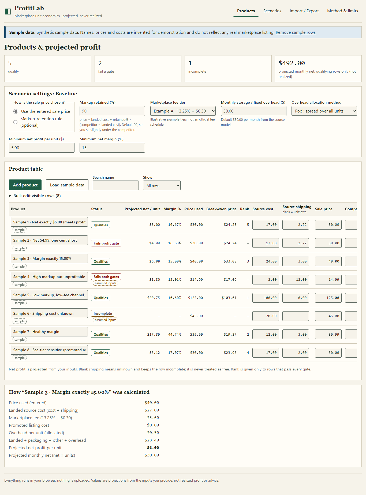

# ProfitLab

A browser-only marketplace unit-economics analyzer: enter source costs, fees and prices, and get exact-decimal projected profit, break-even prices and pass/fail qualification gates per product.



> **Status:** local build, not deployed. There is no hosted demo yet; run it locally (below).
> All numbers are _projections_ from your inputs. ProfitLab never shows realized profit and
> contains no live marketplace data. Built-in fee tiers are illustrative examples, not an
> official fee schedule.

## What it does

- **Editable product table** with source cost, source shipping, sale price, competitor price,
  % and fixed marketplace fees (or inherit a tier), promoted-listing %, packaging, other variable
  cost and monthly units. Sortable, filterable, with bulk edit of visible rows.
- **Exact decimal arithmetic** (decimal.js). Inputs accept at most two decimals; fees round half-up
  at the cent; gates compare exactly.
- **Qualification gates:** minimum net profit and minimum margin (defaults $5.00 and 15%).
  Rows with missing or invalid inputs are _incomplete_ and can never qualify or be ranked.
- **Break-even price** per product (lowest cent price with net ≥ 0).
- **Optional markup-retention pricing** (default 90%): shows the exact equation and the undercut
  versus the competitor.
- **Monthly overhead** (default $30.00) allocated by an explicit method; choosing "none" is allowed
  but flagged everywhere because it overstates profit.
- **Observed vs assumed** labels on cost and price inputs, carried into exports.
- **Scenarios:** save, duplicate, rename, activate and compare any two side by side.
- **CSV import** with line-by-line validation you can correct in place; **CSV export** of results
  and of re-importable inputs; workspace JSON export/import.
- **Persistence** in `localStorage` with schema validation, corruption recovery and a refusal to
  overwrite data written by a newer schema.
- Clearly labeled **synthetic sample data**, designed around the gate boundaries.

## Quick start

Requires Node.js 20.19+ (developed on 24).

```bash
npm ci
npm run dev        # http://localhost:5173/profit-lab/
```

## Commands

| Command             | What it runs                                                        |
| ------------------- | ------------------------------------------------------------------- |
| `npm test`          | Vitest: domain, CSV, storage and 600-case oracle comparison         |
| `npm run e2e`       | Playwright against the production build served under `/profit-lab/` |
| `npm run lint`      | ESLint                                                              |
| `npm run typecheck` | `tsc --noEmit` (strict)                                             |
| `npm run build`     | typecheck + production build to `dist/`                             |
| `npm run secrets`   | local secret / personal-data scan                                   |
| `npm run verify`    | all of the above in order (also `scripts/verify.ps1`, `verify.sh`)  |

Local e2e uses the installed Microsoft Edge; CI installs Chromium (`CI` environment variable).

## Stack

Vite 8, React 19, TypeScript 6 (strict), decimal.js, Zod, Vitest, Playwright. No backend.

## Docs

[Architecture](docs/architecture.md) · [Demo walkthrough](docs/demo.md) ·
[Known limitations](docs/known-limitations.md) · [Test report](docs/test-report.md) ·
[Backlog](docs/backlog.md) · [Handoff](docs/handoff.md)

## Scope and policy note

ProfitLab only does arithmetic on numbers you provide. It does not create listings, place or
fulfil orders, or interact with buyers, and it does not claim any sourcing model is permitted by a
marketplace. Read the marketplace's current policies yourself.

## License

MIT, see [LICENSE](LICENSE). AI-assistance disclosure: [AI_ASSISTANCE.md](AI_ASSISTANCE.md).
